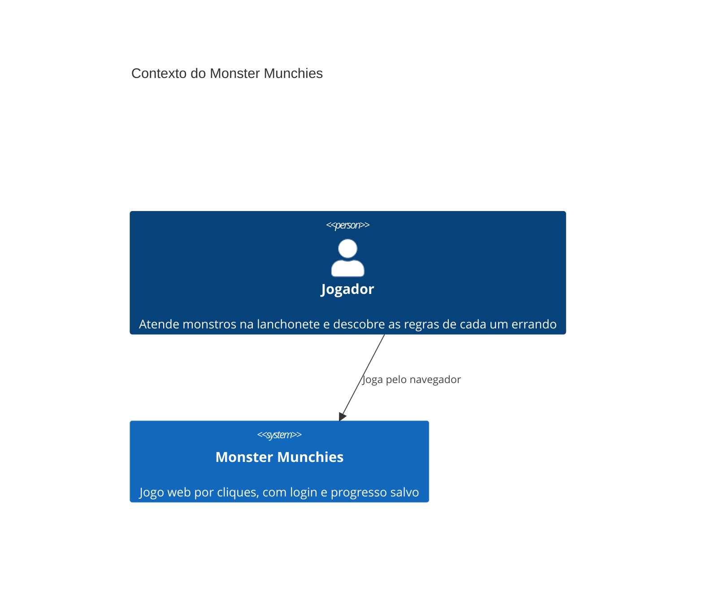

# C4 nível 1: Contexto

> **Gerado depois do MVP.** Este diagrama não guiou a construção: o código veio primeiro, e o diagrama documenta o sistema como ele ficou.

Monster Munchies roda inteiro na máquina de quem joga. Não há sistemas externos: nenhum serviço de autenticação, de e-mail ou de hospedagem.

