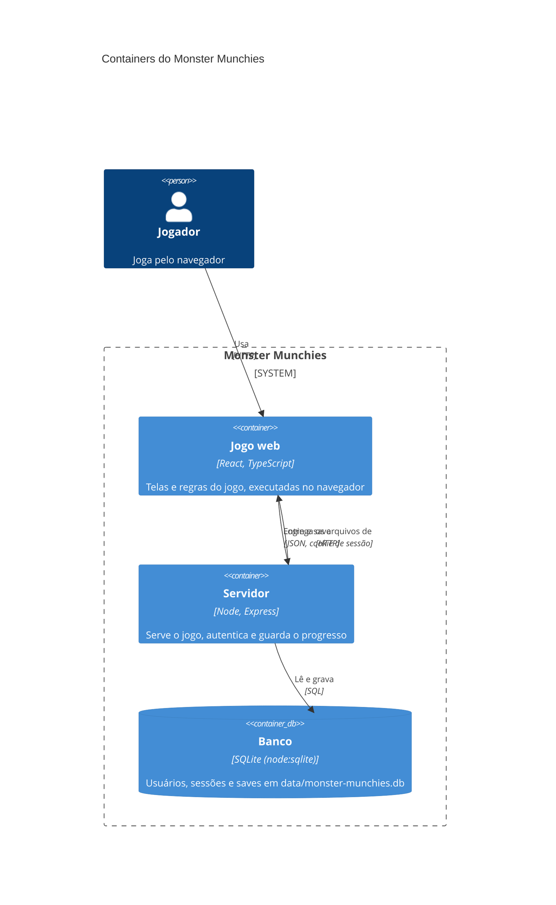

# C4 nível 2: Container

> **Gerado depois do MVP.** Este diagrama não guiou a construção: o código veio primeiro, e o diagrama documenta o sistema como ele ficou.

Em `npm start`, o mesmo processo Node serve os arquivos do jogo e a API, em `http://localhost:3001`. O motivo de rodar localmente está em [ADR-0002](../adr/0002-jogo-web-local-com-persistencia-por-ultimo.md).

