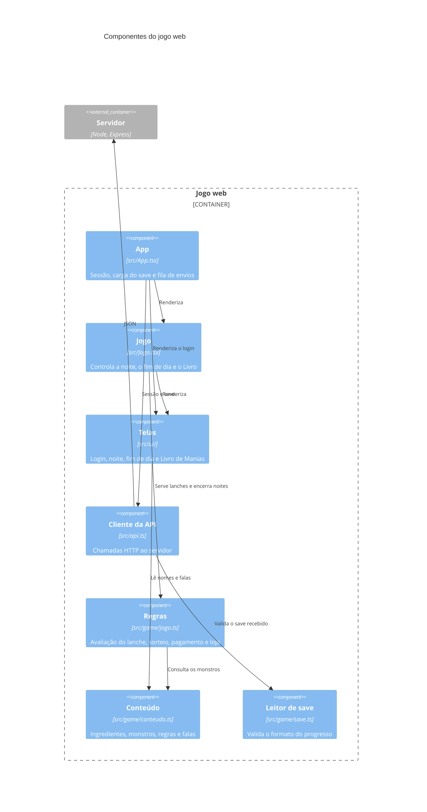
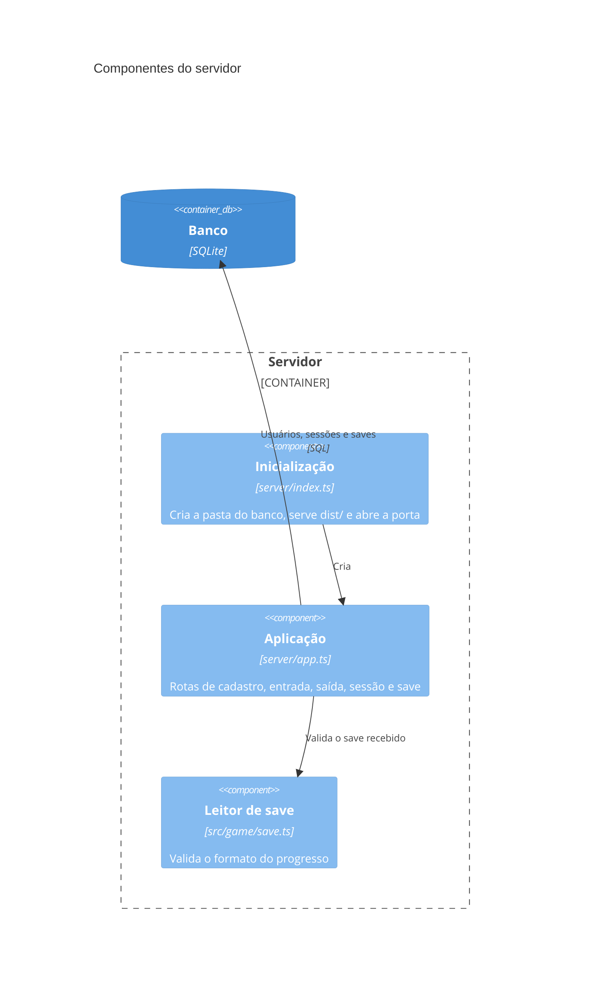

# C4 nível 3: Componentes

> **Gerado depois do MVP.** Este diagrama não guiou a construção: o código veio primeiro, e o diagrama documenta o sistema como ele ficou.

As regras do jogo ficam em `src/game/`, em funções puras, sem depender de React nem do servidor. O servidor reutiliza `save.ts` para validar o progresso recebido.

## Jogo web

## Servidor

