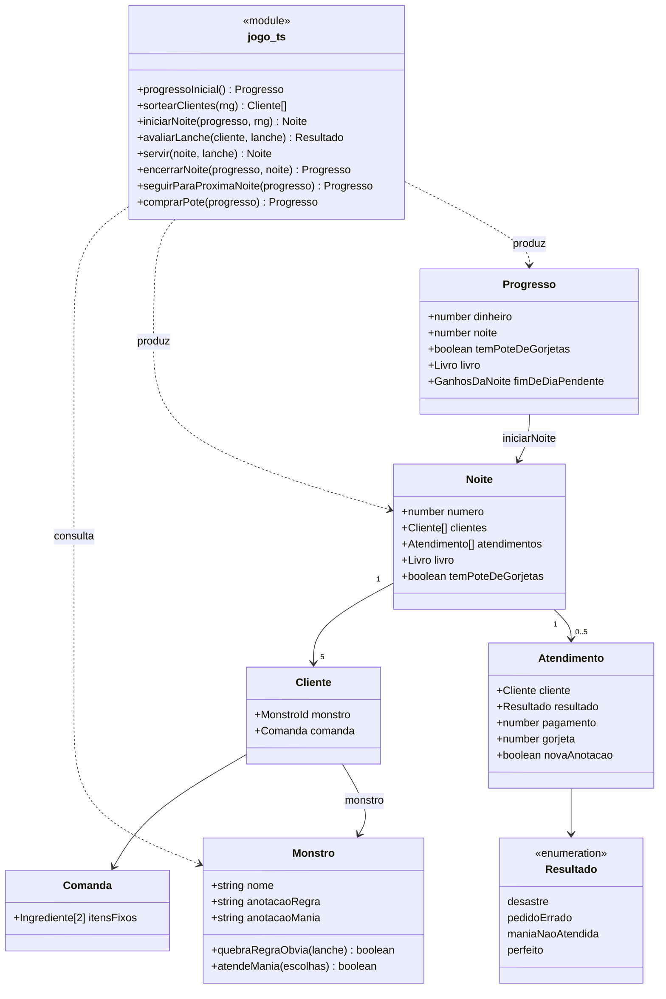

# C4 nível 4: Código

> **Gerado depois do MVP.** Este diagrama não guiou a construção: o código veio primeiro, e o diagrama documenta o sistema como ele ficou.

Principais tipos e funções de `src/game/jogo.ts` e `src/game/conteudo.ts`. Os módulos aparecem como classes porque o Mermaid não tem notação própria para funções soltas.

